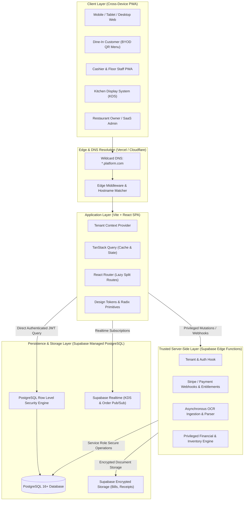

# System Architecture Specification

## 1. Architectural Philosophy: The Governed Modular Monolith

To achieve commercial reliability, developer velocity, and maintainable operations without premature microservice overhead, the platform is architected as a **Governed Modular Monolith**.

- **Frontend**: A single, high-performance Single Page Application (SPA) / Progressive Web Application (PWA) with route-level code splitting and tenant theme injection.
- **Backend Infrastructure**: Managed Supabase PostgreSQL with built-in connection pooling (pgBouncer/Supavisor), Row Level Security (RLS), Supabase Storage, and Supabase Edge Functions (Deno/TypeScript) for trusted server-side computation.
- **Data Isolation**: Shared schema, multi-tenant logical partitioning via PostgreSQL Row Level Security (RLS) driven by verified session claims.



---

## 2. Technology Stack & Decision Rationale

### 2.1 Frontend Stack
- **Framework**: React 18+ with strict TypeScript (`tsconfig` strict mode enabled).
- **Bundler & Tooling**: Vite for minimal build times, instant HMR, and granular manual chunk splitting.
- **Styling**: Tailwind CSS with CSS custom variables for dynamic, tenant-level theme tokens (primary colors, font styles, corner radii).
- **Component Primitives**: Radix UI primitives (headless, unstyled, fully accessible according to WAI-ARIA standards).
- **Routing**: React Router 6+ with dynamic `React.lazy()` imports per module (`/pos`, `/kitchen`, `/inventory`, `/reports`, `/admin`).
- **Server State Management**: TanStack Query (v5) providing automated background re-fetching, optimistic updates, request deduplication, and normalized cache keys.
- **Client State Management**: Zustand reserved strictly for transient UI state (e.g., active POS cart, table drag-and-drop coordinates, active modal stacks). Persistent business state remains exclusively in TanStack Query.
- **Form Handling & Validation**: React Hook Form coupled with Zod schemas. Zod schemas are shared between frontend form validation and Edge Function payloads.
- **PWA Capabilities**: Service worker for caching static assets, enabling instant app launching, and offline shell display.

### 2.2 Backend & Data Stack
- **Database**: PostgreSQL 16+ via Supabase. Native JSONB support for document extractions, composite indexes for multi-tenant query plans, and transactional PL/pgSQL routines for high-concurrency order/stock operations.
- **Authentication**: Supabase Auth (GoTrue). Issuing signed RS256 JWTs enriched with tenant membership metadata.
- **Authorization**: Row Level Security (RLS) policies embedded directly in PostgreSQL. Every query automatically executes with a validated `organization_id` constraint.
- **Live State Updates**: Supabase Realtime using PostgreSQL Logical Replication (`wal2json`) filtered strictly by `tenant_id` and `branch_id` for KDS bump bars and active table status.
- **Trusted Server Layer**: Supabase Edge Functions (Deno runtime) for operations that cannot be trusted to client-side RLS:
  - Third-party payment gateway charge/capture/webhooks.
  - Multi-table ledger posting (preventing race conditions or client tampering).
  - Asynchronous OCR pipeline processing.
  - SaaS subscription entitlement enforcement.
- **Storage**: Supabase Storage with bucket-level RLS policies. Documents (receipts, compliance certs) are private and require signed URLs or authenticated tenant access.

---

## 3. Hostname Resolution & Tenant Routing

### 3.1 Domain Hierarchy
- **Marketing & Onboarding**: `platform.com`
- **Global Auth & Superadmin**: `app.platform.com`
- **Tenant Subdomain**: `{tenant-slug}.platform.com` (e.g., `marian.platform.com`)
- **Customer QR Menu**: `{tenant-slug}.platform.com/m/{branch-slug}/{table-token}`
- **Custom Domains (Future-Proof Architecture)**: `pos.mariancafe.com` routed via CNAME through Edge DNS with automated SSL certificate provisioning.

### 3.2 Tenant Resolution Flow
1. **Edge Request**: Incoming request hits Vercel Edge Middleware.
2. **Hostname Extraction**: Host header is parsed (e.g., `cafeone.platform.com` -> `cafeone`).
3. **Reserved Slug Check**: Reserved slugs (`app`, `admin`, `api`, `auth`, `www`, `billing`, `status`) are directed to platform-level routes.
4. **Tenant Metadata Injection**:
   - For web requests, tenant slug is placed into request context.
   - The application fetches lightweight tenant metadata (`id`, `name`, `theme_config`, `active_status`) via public cached edge endpoint.
5. **Session Verification**: The authenticated user's JWT is inspected. If the user's active organization does not match the resolved subdomain, the user is redirected to the appropriate tenant portal or prompted to switch organizations.

---

## 4. Module Boundaries & Communication Patterns

To preserve modularity within the monolith, each business domain is isolated into dedicated directories with explicit public APIs:

```
src/
├── core/                  # Shared primitives, base hooks, HTTP client, security utilities
├── design-system/         # Radix primitives, Tailwind theme variables, UI components
├── modules/
│   ├── auth/              # Login, tenant selection, session lifecycle
│   ├── pos/               # Active cart, barcode scanning, quick pay, split bill
│   ├── kitchen/           # KDS display, ticket bumping, station routing
│   ├── menu/              # Categories, items, modifiers, pricing tiers
│   ├── tables/            # Table layout, visual floor map, seating timers
│   ├── inventory/         # Stock movements, batches, recipe links, wastage
│   ├── purchasing/        # Suppliers, purchase orders, goods receipt notes
│   ├── ocr/               # Document upload, extraction viewer, approval workflow
│   ├── finance/           # Cash drawer reconciliation, P&L, journal ledger
│   ├── staff/             # Attendance, PIN verification, duty checklists
│   ├── crm/               # Customer directory, loyalty points, dining history
│   └── settings/          # Branch config, tax definitions, receipt templates
└── routes/                # Route definitions & lazy-loaded view wrappers
```

### In-Memory vs. Asynchronous Communication Rules
- **Direct Synchronous Calls**: A module may query another module's public data interface only through typed TanStack Query hooks.
- **Cross-Domain Side Effects**: Triggered via database triggers or Edge Function orchestrators (e.g., Order Confirmation -> KOT Generation -> Realtime Publish -> Inventory Reservation).
- **Long-Running Workflows (OCR, Nightly Reports)**: Offloaded to asynchronous task queues processed via idempotent Edge Functions.

---

## 5. Concurrency Control & Idempotency Strategy

In a busy café environment, multiple cashiers, mobile waiters, and customer QR orders may hit the same table or stock record simultaneously.

1. **Idempotency Keys**:
   - Every mutation that alters financial state, order state, or stock state requires an `idempotency_key` generated client-side (UUIDv4).
   - Database tables `orders`, `payments`, and `stock_movements` enforce a `UNIQUE (tenant_id, idempotency_key)` constraint.
   - Retried requests return the original transaction result without re-executing business logic.
2. **Pessimistic Locking for Sensitive Resources**:
   - Table seating and Bill Settlement execute inside transactional PL/pgSQL functions utilizing `SELECT ... FOR UPDATE` on the specific `tables` or `orders` row to prevent double-billing or double-seating.
3. **Optimistic Concurrency for Catalog and Recipes**:
   - Entity tables incorporate a `version INT DEFAULT 1` column. Mutations verify `WHERE id = :id AND version = :version`, incrementing on write to prevent concurrent overwrite hazards.

---

## 6. Edge Function Architecture for Privileged Operations

The client is intentionally restricted from writing directly to sensitive ledger tables via client-side Supabase client. The following privileged workflows run exclusively inside Supabase Edge Functions authenticated via service-role connection:

1. **`process-order-settlement`**: Validates payment authorization, calculates final tax and discount allocations, marks the order as paid, generates financial journal entries, and registers stock deductions atomically.
2. **`ocr-document-pipeline`**: Receives document upload webhook, calls vision OCR extractor, parses line items against inventory catalog, and generates candidate GRN/Expense records.
3. **`daily-financial-close`**: Aggregates shift drawer cash reports, computes variance, locks the operational day, and writes the immutable daily Z-Report ledger.
