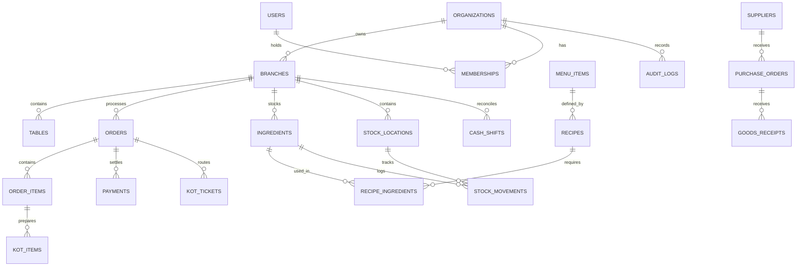

# Database Design & Entity Relationship Specification

## 1. Relational Modeling Principles

1. **Strict Multi-Tenancy**: Every tenant-owned table includes `tenant_id UUID NOT NULL REFERENCES organizations(id) ON DELETE RESTRICT`. Branch-scoped tables additionally enforce `branch_id UUID NOT NULL REFERENCES branches(id) ON DELETE RESTRICT`.
2. **Immutable Ledgers for Financial and Inventory State**: Quantities and balances are derived from append-only movement and journal ledgers (`stock_movements`, `financial_journal_entries`). Snapshot balances are updated via atomic database triggers for query efficiency.
3. **Monetary Precision**: All currency amounts use `NUMERIC(12, 4)` to eliminate floating-point rounding errors across line-item tax and discount distributions.
4. **Idempotency & Auditing**: High-value operational tables enforce unique idempotency constraints and maintain `created_at`, `created_by`, `updated_at`, `updated_by`, and `version` columns.



---

## 2. Core Schemas & Entity Definitions

### 2.1 Multi-Tenant Organization & Governance

```sql
-- 1. Organizations (Tenants)
CREATE TABLE organizations (
    id UUID PRIMARY KEY DEFAULT gen_random_uuid(),
    slug VARCHAR(63) NOT NULL UNIQUE,
    name VARCHAR(255) NOT NULL,
    legal_name VARCHAR(255),
    tax_id VARCHAR(64),
    base_currency VARCHAR(3) NOT NULL DEFAULT 'USD',
    currency_symbol VARCHAR(8) NOT NULL DEFAULT '$',
    currency_decimals SMALLINT NOT NULL DEFAULT 2,
    timezone VARCHAR(64) NOT NULL DEFAULT 'UTC',
    is_active BOOLEAN NOT NULL DEFAULT TRUE,
    created_at TIMESTAMPTZ NOT NULL DEFAULT NOW(),
    updated_at TIMESTAMPTZ NOT NULL DEFAULT NOW(),
    version INT NOT NULL DEFAULT 1
);
CREATE INDEX idx_org_slug ON organizations(slug);

-- 2. Branches
CREATE TABLE branches (
    id UUID PRIMARY KEY DEFAULT gen_random_uuid(),
    tenant_id UUID NOT NULL REFERENCES organizations(id) ON DELETE RESTRICT,
    slug VARCHAR(63) NOT NULL,
    name VARCHAR(255) NOT NULL,
    phone VARCHAR(32),
    email VARCHAR(255),
    address_line1 VARCHAR(255) NOT NULL,
    address_line2 VARCHAR(255),
    city VARCHAR(100) NOT NULL,
    state VARCHAR(100),
    postal_code VARCHAR(32),
    country VARCHAR(2) NOT NULL,
    tax_rate NUMERIC(6, 4) NOT NULL DEFAULT 0.0000,
    service_charge_rate NUMERIC(6, 4) NOT NULL DEFAULT 0.0000,
    is_active BOOLEAN NOT NULL DEFAULT TRUE,
    created_at TIMESTAMPTZ NOT NULL DEFAULT NOW(),
    updated_at TIMESTAMPTZ NOT NULL DEFAULT NOW(),
    CONSTRAINT uq_branch_slug_per_tenant UNIQUE (tenant_id, slug)
);
CREATE INDEX idx_branches_tenant ON branches(tenant_id);

-- 3. Users, Memberships & Permissions
CREATE TABLE memberships (
    id UUID PRIMARY KEY DEFAULT gen_random_uuid(),
    tenant_id UUID NOT NULL REFERENCES organizations(id) ON DELETE CASCADE,
    user_id UUID NOT NULL REFERENCES auth.users(id) ON DELETE CASCADE,
    role VARCHAR(32) NOT NULL CHECK (role IN ('owner', 'general_manager', 'branch_manager', 'cashier', 'kitchen', 'waiter', 'auditor')),
    permissions JSONB NOT NULL DEFAULT '[]'::jsonb,
    is_active BOOLEAN NOT NULL DEFAULT TRUE,
    created_at TIMESTAMPTZ NOT NULL DEFAULT NOW(),
    updated_at TIMESTAMPTZ NOT NULL DEFAULT NOW(),
    CONSTRAINT uq_membership_user_tenant UNIQUE (tenant_id, user_id)
);
CREATE INDEX idx_memberships_tenant_user ON memberships(tenant_id, user_id);

CREATE TABLE user_branch_assignments (
    id UUID PRIMARY KEY DEFAULT gen_random_uuid(),
    tenant_id UUID NOT NULL REFERENCES organizations(id) ON DELETE CASCADE,
    membership_id UUID NOT NULL REFERENCES memberships(id) ON DELETE CASCADE,
    branch_id UUID NOT NULL REFERENCES branches(id) ON DELETE CASCADE,
    created_at TIMESTAMPTZ NOT NULL DEFAULT NOW(),
    CONSTRAINT uq_user_branch UNIQUE (membership_id, branch_id)
);
```

### 2.2 Menu, Catalog & Recipe System

```sql
-- 4. Menu Categories
CREATE TABLE menu_categories (
    id UUID PRIMARY KEY DEFAULT gen_random_uuid(),
    tenant_id UUID NOT NULL REFERENCES organizations(id) ON DELETE RESTRICT,
    branch_id UUID REFERENCES branches(id) ON DELETE CASCADE, -- NULL means org-wide
    name VARCHAR(100) NOT NULL,
    description TEXT,
    display_order INT NOT NULL DEFAULT 0,
    color_code VARCHAR(7) DEFAULT '#1e293b',
    is_active BOOLEAN NOT NULL DEFAULT TRUE,
    created_at TIMESTAMPTZ NOT NULL DEFAULT NOW()
);
CREATE INDEX idx_menu_categories ON menu_categories(tenant_id, branch_id, display_order);

-- 5. Menu Items
CREATE TABLE menu_items (
    id UUID PRIMARY KEY DEFAULT gen_random_uuid(),
    tenant_id UUID NOT NULL REFERENCES organizations(id) ON DELETE RESTRICT,
    category_id UUID NOT NULL REFERENCES menu_categories(id) ON DELETE RESTRICT,
    sku VARCHAR(64),
    name VARCHAR(255) NOT NULL,
    description TEXT,
    base_price NUMERIC(12, 4) NOT NULL CHECK (base_price >= 0),
    cost_price NUMERIC(12, 4) NOT NULL DEFAULT 0.0000,
    tax_rate NUMERIC(6, 4), -- NULL falls back to branch default
    is_available BOOLEAN NOT NULL DEFAULT TRUE,
    kitchen_station VARCHAR(32) NOT NULL DEFAULT 'main_kitchen', -- 'kitchen', 'bar', 'grill', etc.
    image_url TEXT,
    dietary_tags TEXT[] DEFAULT '{}',
    created_at TIMESTAMPTZ NOT NULL DEFAULT NOW(),
    updated_at TIMESTAMPTZ NOT NULL DEFAULT NOW()
);
CREATE INDEX idx_menu_items_tenant_cat ON menu_items(tenant_id, category_id);

-- 6. Item Modifiers & Groups
CREATE TABLE modifier_groups (
    id UUID PRIMARY KEY DEFAULT gen_random_uuid(),
    tenant_id UUID NOT NULL REFERENCES organizations(id) ON DELETE RESTRICT,
    name VARCHAR(100) NOT NULL, -- e.g., 'Milk Choice', 'Extra Shots', 'Temperature'
    min_selection INT NOT NULL DEFAULT 0,
    max_selection INT NOT NULL DEFAULT 1,
    is_required BOOLEAN NOT NULL DEFAULT FALSE,
    created_at TIMESTAMPTZ NOT NULL DEFAULT NOW()
);

CREATE TABLE modifiers (
    id UUID PRIMARY KEY DEFAULT gen_random_uuid(),
    tenant_id UUID NOT NULL REFERENCES organizations(id) ON DELETE RESTRICT,
    group_id UUID NOT NULL REFERENCES modifier_groups(id) ON DELETE CASCADE,
    name VARCHAR(100) NOT NULL,
    additional_price NUMERIC(12, 4) NOT NULL DEFAULT 0.0000,
    cost_price NUMERIC(12, 4) NOT NULL DEFAULT 0.0000,
    is_available BOOLEAN NOT NULL DEFAULT TRUE
);

-- 7. Recipe Bill of Materials (BOM)
CREATE TABLE recipes (
    id UUID PRIMARY KEY DEFAULT gen_random_uuid(),
    tenant_id UUID NOT NULL REFERENCES organizations(id) ON DELETE RESTRICT,
    menu_item_id UUID NOT NULL REFERENCES menu_items(id) ON DELETE CASCADE,
    yield_servings NUMERIC(8, 2) NOT NULL DEFAULT 1.00,
    preparation_instructions TEXT,
    created_at TIMESTAMPTZ NOT NULL DEFAULT NOW(),
    CONSTRAINT uq_recipe_menu_item UNIQUE (tenant_id, menu_item_id)
);

CREATE TABLE recipe_ingredients (
    id UUID PRIMARY KEY DEFAULT gen_random_uuid(),
    tenant_id UUID NOT NULL REFERENCES organizations(id) ON DELETE RESTRICT,
    recipe_id UUID NOT NULL REFERENCES recipes(id) ON DELETE CASCADE,
    ingredient_id UUID NOT NULL REFERENCES ingredients(id) ON DELETE RESTRICT,
    quantity NUMERIC(12, 4) NOT NULL CHECK (quantity > 0),
    unit VARCHAR(16) NOT NULL, -- 'g', 'ml', 'pcs'
    wastage_percentage NUMERIC(5, 2) NOT NULL DEFAULT 0.00
);
```

### 2.3 Tables, Orders, KOT & Payments

```sql
-- 8. Dining Tables
CREATE TABLE dining_tables (
    id UUID PRIMARY KEY DEFAULT gen_random_uuid(),
    tenant_id UUID NOT NULL REFERENCES organizations(id) ON DELETE RESTRICT,
    branch_id UUID NOT NULL REFERENCES branches(id) ON DELETE CASCADE,
    table_number VARCHAR(32) NOT NULL,
    section VARCHAR(64) NOT NULL DEFAULT 'main',
    capacity INT NOT NULL DEFAULT 4,
    current_status VARCHAR(32) NOT NULL DEFAULT 'vacant' CHECK (current_status IN ('vacant', 'occupied', 'billed', 'reserved', 'cleaning')),
    qr_token UUID NOT NULL DEFAULT gen_random_uuid() UNIQUE,
    created_at TIMESTAMPTZ NOT NULL DEFAULT NOW(),
    CONSTRAINT uq_branch_table_number UNIQUE (branch_id, table_number)
);

-- 9. Orders
CREATE TABLE orders (
    id UUID PRIMARY KEY DEFAULT gen_random_uuid(),
    tenant_id UUID NOT NULL REFERENCES organizations(id) ON DELETE RESTRICT,
    branch_id UUID NOT NULL REFERENCES branches(id) ON DELETE RESTRICT,
    table_id UUID REFERENCES dining_tables(id) ON DELETE SET NULL,
    order_number VARCHAR(32) NOT NULL, -- Daily human-readable sequence
    order_type VARCHAR(32) NOT NULL CHECK (order_type IN ('dine_in', 'takeaway', 'delivery', 'qr_self_order')),
    status VARCHAR(32) NOT NULL DEFAULT 'draft' CHECK (status IN ('draft', 'confirmed', 'in_prep', 'ready', 'served', 'completed', 'cancelled')),
    guest_count INT DEFAULT 1,
    subtotal_amount NUMERIC(12, 4) NOT NULL DEFAULT 0.0000,
    discount_amount NUMERIC(12, 4) NOT NULL DEFAULT 0.0000,
    discount_reason TEXT,
    tax_amount NUMERIC(12, 4) NOT NULL DEFAULT 0.0000,
    service_charge_amount NUMERIC(12, 4) NOT NULL DEFAULT 0.0000,
    total_amount NUMERIC(12, 4) NOT NULL DEFAULT 0.0000,
    paid_amount NUMERIC(12, 4) NOT NULL DEFAULT 0.0000,
    customer_id UUID REFERENCES customers(id) ON DELETE SET NULL,
    cashier_user_id UUID REFERENCES auth.users(id),
    notes TEXT,
    idempotency_key VARCHAR(64),
    created_at TIMESTAMPTZ NOT NULL DEFAULT NOW(),
    updated_at TIMESTAMPTZ NOT NULL DEFAULT NOW(),
    CONSTRAINT uq_order_idempotency UNIQUE (tenant_id, idempotency_key)
);
CREATE INDEX idx_orders_tenant_branch_status ON orders(tenant_id, branch_id, status, created_at DESC);

-- 10. Order Line Items
CREATE TABLE order_items (
    id UUID PRIMARY KEY DEFAULT gen_random_uuid(),
    tenant_id UUID NOT NULL REFERENCES organizations(id) ON DELETE RESTRICT,
    order_id UUID NOT NULL REFERENCES orders(id) ON DELETE CASCADE,
    menu_item_id UUID NOT NULL REFERENCES menu_items(id) ON DELETE RESTRICT,
    item_name VARCHAR(255) NOT NULL,
    unit_price NUMERIC(12, 4) NOT NULL,
    quantity INT NOT NULL CHECK (quantity > 0),
    discount_amount NUMERIC(12, 4) NOT NULL DEFAULT 0.0000,
    tax_amount NUMERIC(12, 4) NOT NULL DEFAULT 0.0000,
    total_price NUMERIC(12, 4) NOT NULL,
    selected_modifiers JSONB DEFAULT '[]'::jsonb,
    special_instructions TEXT,
    status VARCHAR(32) NOT NULL DEFAULT 'pending' CHECK (status IN ('pending', 'sent_to_kitchen', 'preparing', 'ready', 'served', 'cancelled')),
    created_at TIMESTAMPTZ NOT NULL DEFAULT NOW()
);
CREATE INDEX idx_order_items_order ON order_items(order_id);

-- 11. Kitchen Order Tickets (KOT)
CREATE TABLE kot_tickets (
    id UUID PRIMARY KEY DEFAULT gen_random_uuid(),
    tenant_id UUID NOT NULL REFERENCES organizations(id) ON DELETE RESTRICT,
    branch_id UUID NOT NULL REFERENCES branches(id) ON DELETE RESTRICT,
    order_id UUID NOT NULL REFERENCES orders(id) ON DELETE CASCADE,
    kot_number VARCHAR(32) NOT NULL,
    station VARCHAR(32) NOT NULL DEFAULT 'main_kitchen',
    status VARCHAR(32) NOT NULL DEFAULT 'queued' CHECK (status IN ('queued', 'in_progress', 'ready', 'bumped')),
    created_at TIMESTAMPTZ NOT NULL DEFAULT NOW(),
    bumped_at TIMESTAMPTZ
);
CREATE INDEX idx_kot_tickets_active ON kot_tickets(tenant_id, branch_id, status);

-- 12. Payments & Refunds
CREATE TABLE payments (
    id UUID PRIMARY KEY DEFAULT gen_random_uuid(),
    tenant_id UUID NOT NULL REFERENCES organizations(id) ON DELETE RESTRICT,
    branch_id UUID NOT NULL REFERENCES branches(id) ON DELETE RESTRICT,
    order_id UUID NOT NULL REFERENCES orders(id) ON DELETE RESTRICT,
    payment_method VARCHAR(32) NOT NULL CHECK (payment_method IN ('cash', 'card', 'upi_qr', 'wallet', 'account')),
    amount NUMERIC(12, 4) NOT NULL CHECK (amount > 0),
    tip_amount NUMERIC(12, 4) NOT NULL DEFAULT 0.0000,
    reference_number VARCHAR(128),
    status VARCHAR(32) NOT NULL DEFAULT 'completed' CHECK (status IN ('pending', 'completed', 'failed', 'refunded')),
    idempotency_key VARCHAR(64) NOT NULL,
    settled_by UUID REFERENCES auth.users(id),
    created_at TIMESTAMPTZ NOT NULL DEFAULT NOW(),
    CONSTRAINT uq_payment_idempotency UNIQUE (tenant_id, idempotency_key)
);
CREATE INDEX idx_payments_tenant_branch ON payments(tenant_id, branch_id, created_at DESC);

CREATE TABLE payment_refunds (
    id UUID PRIMARY KEY DEFAULT gen_random_uuid(),
    tenant_id UUID NOT NULL REFERENCES organizations(id) ON DELETE RESTRICT,
    payment_id UUID NOT NULL REFERENCES payments(id) ON DELETE RESTRICT,
    refund_amount NUMERIC(12, 4) NOT NULL CHECK (refund_amount > 0),
    reason TEXT NOT NULL,
    approved_by UUID NOT NULL REFERENCES auth.users(id),
    idempotency_key VARCHAR(64) NOT NULL,
    created_at TIMESTAMPTZ NOT NULL DEFAULT NOW(),
    CONSTRAINT uq_refund_idempotency UNIQUE (tenant_id, idempotency_key)
);
```

### 2.4 Inventory, Stock Movement & Supply Chain

```sql
-- 13. Ingredients Master
CREATE TABLE ingredients (
    id UUID PRIMARY KEY DEFAULT gen_random_uuid(),
    tenant_id UUID NOT NULL REFERENCES organizations(id) ON DELETE RESTRICT,
    name VARCHAR(255) NOT NULL,
    sku VARCHAR(64),
    category VARCHAR(64),
    base_unit VARCHAR(16) NOT NULL, -- 'g', 'ml', 'pcs'
    reorder_level NUMERIC(12, 4) NOT NULL DEFAULT 0.0000,
    current_cost_price NUMERIC(12, 4) NOT NULL DEFAULT 0.0000,
    is_active BOOLEAN NOT NULL DEFAULT TRUE,
    created_at TIMESTAMPTZ NOT NULL DEFAULT NOW()
);
CREATE INDEX idx_ingredients_tenant ON ingredients(tenant_id);

-- 14. Stock Locations
CREATE TABLE stock_locations (
    id UUID PRIMARY KEY DEFAULT gen_random_uuid(),
    tenant_id UUID NOT NULL REFERENCES organizations(id) ON DELETE RESTRICT,
    branch_id UUID NOT NULL REFERENCES branches(id) ON DELETE CASCADE,
    name VARCHAR(100) NOT NULL, -- 'Central Storage', 'Bar Station', 'Prep Kitchen'
    is_active BOOLEAN NOT NULL DEFAULT TRUE,
    created_at TIMESTAMPTZ NOT NULL DEFAULT NOW()
);

-- 15. Immutable Stock Movements Ledger
CREATE TABLE stock_movements (
    id UUID PRIMARY KEY DEFAULT gen_random_uuid(),
    tenant_id UUID NOT NULL REFERENCES organizations(id) ON DELETE RESTRICT,
    branch_id UUID NOT NULL REFERENCES branches(id) ON DELETE RESTRICT,
    ingredient_id UUID NOT NULL REFERENCES ingredients(id) ON DELETE RESTRICT,
    location_id UUID NOT NULL REFERENCES stock_locations(id) ON DELETE RESTRICT,
    movement_type VARCHAR(32) NOT NULL CHECK (movement_type IN ('purchase_receipt', 'sale_consumption', 'waste', 'manual_adjustment', 'transfer_in', 'transfer_out')),
    quantity NUMERIC(12, 4) NOT NULL, -- Positive for addition, negative for deduction
    unit_cost NUMERIC(12, 4) NOT NULL,
    total_cost NUMERIC(12, 4) NOT NULL,
    reference_id UUID, -- References orders(id), goods_receipts(id), or wastage_logs(id)
    notes TEXT,
    created_by UUID REFERENCES auth.users(id),
    created_at TIMESTAMPTZ NOT NULL DEFAULT NOW()
);
CREATE INDEX idx_stock_movements_ledger ON stock_movements(tenant_id, branch_id, ingredient_id, created_at DESC);

-- 16. Suppliers & Purchase Orders
CREATE TABLE suppliers (
    id UUID PRIMARY KEY DEFAULT gen_random_uuid(),
    tenant_id UUID NOT NULL REFERENCES organizations(id) ON DELETE RESTRICT,
    company_name VARCHAR(255) NOT NULL,
    contact_person VARCHAR(100),
    phone VARCHAR(32),
    email VARCHAR(255),
    tax_number VARCHAR(64),
    payment_terms_days INT NOT NULL DEFAULT 30,
    is_active BOOLEAN NOT NULL DEFAULT TRUE,
    created_at TIMESTAMPTZ NOT NULL DEFAULT NOW()
);

CREATE TABLE purchase_orders (
    id UUID PRIMARY KEY DEFAULT gen_random_uuid(),
    tenant_id UUID NOT NULL REFERENCES organizations(id) ON DELETE RESTRICT,
    branch_id UUID NOT NULL REFERENCES branches(id) ON DELETE RESTRICT,
    supplier_id UUID NOT NULL REFERENCES suppliers(id) ON DELETE RESTRICT,
    po_number VARCHAR(32) NOT NULL,
    status VARCHAR(32) NOT NULL DEFAULT 'draft' CHECK (status IN ('draft', 'issued', 'partially_received', 'completed', 'cancelled')),
    total_amount NUMERIC(12, 4) NOT NULL DEFAULT 0.0000,
    expected_delivery_date DATE,
    created_by UUID REFERENCES auth.users(id),
    created_at TIMESTAMPTZ NOT NULL DEFAULT NOW()
);

CREATE TABLE goods_receipts (
    id UUID PRIMARY KEY DEFAULT gen_random_uuid(),
    tenant_id UUID NOT NULL REFERENCES organizations(id) ON DELETE RESTRICT,
    branch_id UUID NOT NULL REFERENCES branches(id) ON DELETE RESTRICT,
    purchase_order_id UUID REFERENCES purchase_orders(id),
    supplier_id UUID NOT NULL REFERENCES suppliers(id) ON DELETE RESTRICT,
    grn_number VARCHAR(32) NOT NULL,
    invoice_number VARCHAR(64),
    invoice_date DATE,
    total_invoiced_amount NUMERIC(12, 4) NOT NULL,
    status VARCHAR(32) NOT NULL DEFAULT 'verified' CHECK (status IN ('draft', 'verified', 'disputed')),
    received_by UUID REFERENCES auth.users(id),
    received_at TIMESTAMPTZ NOT NULL DEFAULT NOW()
);
```

### 2.5 Cash Shifts, Expenses & Financial Ledgers

```sql
-- 17. Cash Shifts (Drawer Management)
CREATE TABLE cash_shifts (
    id UUID PRIMARY KEY DEFAULT gen_random_uuid(),
    tenant_id UUID NOT NULL REFERENCES organizations(id) ON DELETE RESTRICT,
    branch_id UUID NOT NULL REFERENCES branches(id) ON DELETE RESTRICT,
    opened_by UUID NOT NULL REFERENCES auth.users(id),
    closed_by UUID REFERENCES auth.users(id),
    opened_at TIMESTAMPTZ NOT NULL DEFAULT NOW(),
    closed_at TIMESTAMPTZ,
    opening_float NUMERIC(12, 4) NOT NULL DEFAULT 0.0000,
    expected_cash NUMERIC(12, 4) DEFAULT 0.0000,
    actual_cash NUMERIC(12, 4),
    variance NUMERIC(12, 4),
    status VARCHAR(16) NOT NULL DEFAULT 'open' CHECK (status IN ('open', 'closed', 'reconciled'))
);

-- 18. Operating Expenses (OPEX)
CREATE TABLE expenses (
    id UUID PRIMARY KEY DEFAULT gen_random_uuid(),
    tenant_id UUID NOT NULL REFERENCES organizations(id) ON DELETE RESTRICT,
    branch_id UUID NOT NULL REFERENCES branches(id) ON DELETE RESTRICT,
    category VARCHAR(64) NOT NULL, -- 'Utilities', 'Maintenance', 'Salaries', 'Rent', 'Packaging'
    amount NUMERIC(12, 4) NOT NULL CHECK (amount > 0),
    payment_method VARCHAR(32) NOT NULL,
    description TEXT,
    receipt_document_id UUID,
    approved_by UUID REFERENCES auth.users(id),
    incurred_date DATE NOT NULL,
    created_at TIMESTAMPTZ NOT NULL DEFAULT NOW()
);
```

### 2.6 OCR, Document Vault & Auditing

```sql
-- 19. Document Ingestion Vault
CREATE TABLE document_vault (
    id UUID PRIMARY KEY DEFAULT gen_random_uuid(),
    tenant_id UUID NOT NULL REFERENCES organizations(id) ON DELETE RESTRICT,
    branch_id UUID REFERENCES branches(id) ON DELETE SET NULL,
    document_type VARCHAR(32) NOT NULL CHECK (document_type IN ('supplier_invoice', 'thermal_receipt', 'compliance_license', 'staff_document')),
    storage_path TEXT NOT NULL,
    file_size_bytes INT NOT NULL,
    mime_type VARCHAR(64) NOT NULL,
    sha256_hash VARCHAR(64) NOT NULL,
    ocr_status VARCHAR(32) NOT NULL DEFAULT 'pending' CHECK (ocr_status IN ('pending', 'processing', 'needs_review', 'approved', 'rejected')),
    ocr_confidence_score NUMERIC(5, 4),
    extracted_data JSONB DEFAULT '{}'::jsonb,
    reviewed_by UUID REFERENCES auth.users(id),
    reviewed_at TIMESTAMPTZ,
    created_at TIMESTAMPTZ NOT NULL DEFAULT NOW(),
    CONSTRAINT uq_tenant_file_hash UNIQUE (tenant_id, sha256_hash)
);
CREATE INDEX idx_document_vault_tenant_status ON document_vault(tenant_id, ocr_status);

-- 20. Tamper-Evident Audit Logs
CREATE TABLE audit_logs (
    id UUID PRIMARY KEY DEFAULT gen_random_uuid(),
    tenant_id UUID NOT NULL REFERENCES organizations(id) ON DELETE RESTRICT,
    branch_id UUID REFERENCES branches(id) ON DELETE SET NULL,
    actor_id UUID REFERENCES auth.users(id),
    actor_role VARCHAR(32),
    action VARCHAR(64) NOT NULL, -- 'ORDER_CANCELLED', 'DISCOUNT_APPLIED', 'PRICE_CHANGED', 'PERMISSION_GRANTED'
    entity_name VARCHAR(64) NOT NULL,
    entity_id UUID NOT NULL,
    previous_state JSONB,
    new_state JSONB,
    ip_address INET,
    user_agent TEXT,
    created_at TIMESTAMPTZ NOT NULL DEFAULT NOW()
);
CREATE INDEX idx_audit_logs_tenant_created ON audit_logs(tenant_id, created_at DESC);
```
