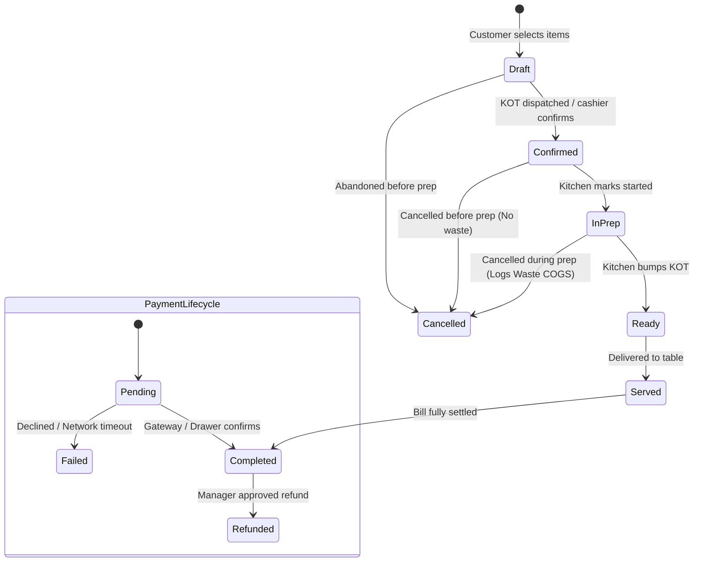

# Financial & Inventory Accounting Architecture

## 1. Core Financial Principles & Separation of Concerns

A fundamental failure of amateur POS systems is treating cash collections as revenue, or treating raw inventory purchases as Cost of Goods Sold (COGS). This platform strictly follows double-entry-aligned accrual accounting principles adapted for restaurant operations.

| Metric | Source of Truth | When Recognized | What It Is NOT |
| :--- | :--- | :--- | :--- |
| **Gross Sales** | Sum of menu items sold at menu price (`order_items.unit_price * quantity`) | When order is confirmed & fulfilled | Does not represent net income or collected cash |
| **Discounts & Comps** | `orders.discount_amount` or item-level discounts | When discount is authorized on order | Is not an operating expense |
| **Net Sales (Revenue)** | `Gross Sales - Discounts` | Recognized upon order fulfillment/completion | Does not include collected sales taxes, service charges or tips |
| **Tax Collected** | `orders.tax_amount` | Recorded on order confirmation | **NEVER** business revenue; liability owed to tax authorities |
| **Payments Collected** | `payments` ledger | When payment is authorized & captured | Does not equal revenue (e.g. includes tax, tips, deposits) |
| **Purchases** | `goods_receipts` ledger | When goods are accepted from supplier | Is **NOT** COGS. Purchases increase Inventory Asset. |
| **Cost of Goods Sold (COGS)**| `stock_movements` (consumption & recipe deduction) | When food is prepared and served | Is **NOT** raw purchase orders or paid supplier invoices |
| **Gross Profit** | `Net Sales - Realized COGS` | Calculated across reporting window | Does not include labor, utilities, or rent |
| **Operating Expenses (OPEX)**| `expenses` ledger (Rent, Labor, Utilities, Cleaning) | Incurred date | Does not include raw food inventory ingredients |
| **Net Operating Profit** | `Gross Profit - OPEX` | Calculated across reporting window | Operational bottom line (excludes interest, taxes, depreciation) |

---

## 2. Order, Payment & Refund State Models

### 2.1 Sales & Revenue Recognition Rules
- **Revenue Recognition Trigger**: Order status in (`'confirmed'`, `'in_prep'`, `'ready'`, `'served'`, `'completed'`).
- **Cancelled / Voided Orders**:
  - Cancelled before prep: Excluded from gross and net sales; stock consumption reversed via positive `return` movements.
  - Cancelled during prep: Reversal recorded; kitchen logs separate `waste` stock movement, recognized under inventory wastage loss, **not** net sales.
- **Taxes & Surcharges**:
  - `tax_amount` is segregated into a balance sheet tax liability account.
  - `service_charge_amount` is segregated for staff distribution or operational fee income.
  - Formula:
    $$\text{Net Sales} = \sum_{\text{eligible orders}} (\text{subtotal\_amount} - \text{discount\_amount})$$
    $$\text{Total Billed} = \text{Net Sales} + \text{Tax Amount} + \text{Service Charge Amount}$$

### 2.2 Payment Collections & Gateway Distinction
- Real collections are tracked per tender: `cash`, `card`, `upi_qr`, `bank_transfer`.
- **Simulated Payment Separation**: Any test or simulated gateway transactions (e.g. `is_simulated = TRUE` or reference prefix `SIM-`) are strictly isolated and never mixed with audited cash register balances or settled card merchant payouts.
- **Refunds**: Recorded as negative settlements against the original payment method in `payment_refunds`.

---

## 3. Inventory Valuation & Cost of Goods Sold (COGS) Engine

The platform implements **Weighted Average Cost (WAC)** for inventory valuation, synchronized perpetually with the Phase 5 stock movements ledger.

### 3.1 Weighted Average Cost Calculation
When a Goods Receipt Note (GRN) is accepted:
$$\text{New Unit Cost} = \frac{(\text{Current Stock} \times \text{Current WAC}) + (\text{Received Qty} \times \text{Invoice Cost})}{\text{Current Stock} + \text{Received Qty}}$$
*(Note: If `Current Stock <= 0`, `New Unit Cost` resets cleanly to `Invoice Cost`).*

### 3.2 Realized COGS vs Inventory Purchases
- **Purchases**: `goods_receipts` transactions increase the asset balance: $\text{Debit: Inventory Asset}, \text{Credit: Accounts Payable}$.
- **Realized COGS**: Generated strictly when meals are sold:
  $$\text{COGS}_{\text{period}} = \sum_{\text{sale\_consumption movements}} (\text{Quantity}_{\text{base}} \times \text{Historical Unit Cost})$$
- **Wastage & Spoilage**: Logged as `movement_type = 'waste'`, reported as a distinct operational variance line item, preventing unconsumed inventory loss from silently inflating normal recipe food cost percentage.
- **Cancellations**: Automatically post compensating `return` movements referencing the order, eliminating unearned COGS.

---

## 4. Cash Shifts & Drawer Reconciliation

Cash shrinkage and drawer discrepancy are high-risk areas in café and restaurant environments. Every physical cashier terminal must operate within an auditable **Cash Shift**.

### 4.1 Cash Session Lifecycle
1. **Open Shift**: Cashier counts and enters **Opening Float** (e.g. $200.00). Shift status is `'open'`.
2. **Operations**:
   - Cash sales from completed orders increase drawer balance.
   - Cash refunds decrease drawer balance.
   - Authorized Cash-In (e.g. adding petty cash change) increases drawer balance.
   - Authorized Cash-Out (e.g. emergency grocery run, tip payout) decreases drawer balance.
3. **Blind Close Shift**: Cashier enters physical cash count without seeing expected total.
4. **Reconciliation**:
   $$\text{Expected Closing Cash} = \text{Opening Float} + \text{Cash Sales} - \text{Cash Refunds} + \text{Cash In} - \text{Cash Out} - \text{Cash Register Expenses}$$
   $$\text{Drawer Variance} = \text{Actual Counted Cash} - \text{Expected Closing Cash}$$

- **Variance = 0**: Balanced drawer.
- **Variance < 0**: Cash Shortage (requires mandatory manager explanation note and audit log).
- **Variance > 0**: Cash Overage (logged as untracked operational income).

---

## 5. Supplier Payables & Purchasing Liabilities

Supplier accounts are maintained on an accrual basis linked to Goods Receipt Notes (GRN).

- **Purchase Order (PO)**: Represents an uncommitted intent to purchase. Does **not** create a financial liability.
- **Goods Receipt Note (GRN)**: Acceptance of physical delivery. Creates an accounts payable liability:
  $$\text{Payable Incurred} = \text{GRN Total Invoiced Amount}$$
- **Supplier Payment**: Recorded when money is disbursed to the vendor (via bank transfer, cheque, or cash):
  $$\text{Outstanding Balance}_{\text{supplier}} = \sum \text{GRN Verified Invoices} - \sum \text{Supplier Payments Disbursed}$$

---

## 6. Financial Reporting Formulas & Exclusions

### 6.1 Standard Income Metrics
$$\text{Gross Profit} = \text{Net Sales} - \text{Realized COGS}$$
$$\text{Gross Margin \%} = \frac{\text{Gross Profit}}{\text{Net Sales}} \times 100$$
$$\text{Operating Expenses (OPEX)} = \sum_{\text{expenses}} (\text{Utilities} + \text{Rent} + \text{Salaries} + \text{Maintenance} + \text{Packaging})$$
$$\text{Net Operating Profit} = \text{Gross Profit} - \text{OPEX}$$

### 6.2 Explicit Accounting Exclusions
> [!NOTE]
> Net Operating Profit reported in this system represents operational earnings before interest, income taxes, depreciation, and amortization (EBITDA proxy). It does not calculate statutory corporate income tax, balance sheet asset depreciation schedules, or leasehold amortization.
