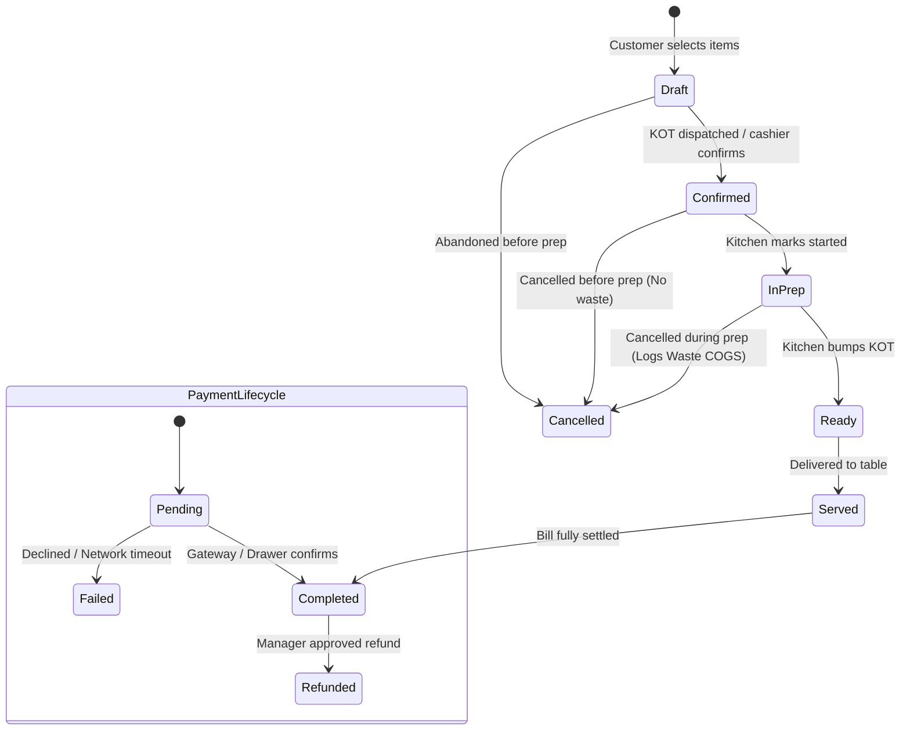

# Financial & Inventory Accounting Architecture

## 1. Core Financial Principles & Separation of Concerns

A fundamental failure of amateur POS systems is treating cash collections as revenue, or treating raw inventory purchases as Cost of Goods Sold (COGS). This platform strictly follows double-entry-aligned accrual accounting principles adapted for restaurant operations.

| Metric | Source of Truth | When Recognized | What It Is NOT |
| :--- | :--- | :--- | :--- |
| **Gross Sales** | Sum of menu items sold at menu price | When order is fulfilled/served | Does not represent net income or collected cash |
| **Net Revenue** | `Gross Sales - Discounts - Comps` | When order is fulfilled/served | Does not include collected sales taxes or tips |
| **Payments Collected** | `payments` ledger | When payment is authorized & captured | Does not equal revenue (e.g. includes tax, tips, deposits) |
| **Purchases** | `goods_receipts` ledger | When goods are accepted from supplier | Is NOT COGS. Purchases increase Inventory Asset. |
| **Cost of Goods Sold (COGS)**| `stock_movements` (consumption & recipe deduction) | When food is prepared and served | Is NOT raw purchase orders or paid supplier invoices |
| **Gross Profit** | `Net Revenue - Realized COGS` | Calculated across reporting window | Does not include labor, utilities, or rent |
| **Operating Expenses (OPEX)**| `expenses` ledger (Rent, Labor, Utilities, Cleaning) | Incurred date | Does not include raw food inventory ingredients |
| **Net Operating Profit** | `Gross Profit - OPEX` | Calculated across reporting window | Pre-tax operational bottom line |

---

## 2. Order, Payment & Refund State Models

### 2.1 Refund & Cancellation Treatment
- **Cancellations Before Kitchen Preparation**: Order is marked `cancelled`. No inventory consumption is posted; no COGS recognized.
- **Cancellations After Preparation**: Order is marked `cancelled`. Kitchen records an automated stock movement of type `waste` with cost recognized under **Wasted Inventory Loss**, not recognized revenue.
- **Post-Settlement Refunds**: Payments are never directly edited or deleted. A corresponding record in `payment_refunds` is created. Net collected payments for the shift are reduced by the refund amount.

---

## 3. Inventory Valuation & COGS Engine

The platform implements **Weighted Average Cost (WAC)** for inventory valuation, with support for First-In-First-Out (FIFO) batch tracking in advanced tiers.

### 3.1 Weighted Average Cost Calculation
When a Goods Receipt Note (GRN) is accepted:
$$\text{New Unit Cost} = \frac{(\text{Current Qty} \times \text{Current Cost}) + (\text{Received Qty} \times \text{Invoice Cost})}{\text{Current Qty} + \text{Received Qty}}$$

### 3.2 COGS Derivation Formula
True COGS is derived continuously via perpetual recipe deductions:
$$\text{COGS}_{\text{order}} = \sum_{i \in \text{ingredients}} (\text{Recipe Qty}_i \times (1 + \text{Wastage Factor}_i) \times \text{Unit Cost}_i)$$

Period-end reconciliation validates perpetual COGS against periodic stocktaking:
$$\text{Reconciled COGS} = \text{Beginning Inventory} + \text{Net Purchases} - \text{Ending Physical Inventory} - \text{Logged Waste}$$

---

## 4. Cash Management & Daily Drawer Reconciliation

Cash shrinkage and drawer discrepancy are high-risk areas in café and restaurant environments.

### 4.1 Cash Shift Formula
$$\text{Expected Ending Cash} = \text{Opening Float} + \text{Cash Sales Collected} - \text{Cash Refunds Issued} - \text{Cash Paid Out (Petty Cash Expenses)}$$

$$\text{Drawer Variance} = \text{Actual Counted Cash} - \text{Expected Ending Cash}$$

- **Variance = 0**: Balanced drawer.
- **Variance < 0**: Cash Shortage (requires mandatory manager explanation note and audit log).
- **Variance > 0**: Cash Overage (logged as untracked income).

---

## 5. Tax, Tip & Rounding Rules

### 5.1 Tax Engine Rules
- **Tax Inclusive vs. Exclusive**: Configured at the organization and branch levels. 
  - *Exclusive*: `Line Total = Price * Qty`, `Tax = Line Total * Tax Rate`.
  - *Inclusive*: `Tax = Line Total - (Line Total / (1 + Tax Rate))`.
- **Jurisdictional Validation Note**:
  > [!IMPORTANT]
  > Tax categories, VAT compliance, electronic fiscal device (EFD) signing, and GST/sales tax rules vary significantly by location (e.g., US state sales tax, EU VAT split between dine-in vs takeaway, India GST with CGST/SGST splits). Specific fiscal signing hardware/APIs must be configured and validated specifically for the target jurisdiction prior to local commercial rollout.
- **Rounding Strategy**: All financial calculations are preserved to 4 decimal places in database records (`NUMERIC(12, 4)`) and rounded using **Bankers Rounding (Half to Even)** to the tenant's configured currency display decimals (default: 2 decimal places) upon invoice rendering.
