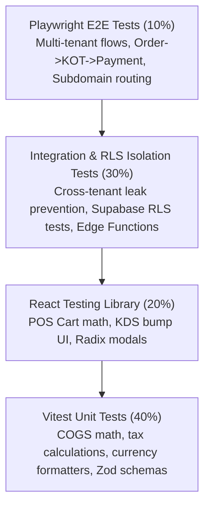

# Performance Standards, Budgets & Comprehensive Testing Strategy

## 1. Performance Budgets & Asset Delivery

Performance in restaurant point-of-sale directly impacts table turnover, cashier queue speed, and customer satisfaction on mobile networks.

### 1.1 Initial Compressed JavaScript Budgets (Gzip/Brotli)
- **Public Customer QR Menu**: **50–100 KB** (Initial load).
  - *Rationale*: Zero-install customer mobile experience. Must render first paint in under 1.5 seconds on spotty 3G/4G indoor café cellular connections.
  - *Included*: React core, routing, lightweight menu viewer, theme engine. Heavy admin/auth dependencies are strictly excluded.
- **Authenticated Staff & Owner Dashboard**: **100–200 KB** (Initial load per route chunk).
  - *Rationale*: Rich operational UI loaded once and cached via PWA Service Worker for the duration of the shift.

### 1.2 Bundle Splitting & Vite Optimization Strategy
- **Manual Chunks Configuration**:
  ```typescript
  // vite.config.ts
  export default defineConfig({
    build: {
      rollupOptions: {
        output: {
          manualChunks: {
            'vendor-react': ['react', 'react-dom', 'react-router-dom'],
            'vendor-query': ['@tanstack/react-query'],
            'vendor-radix': ['@radix-ui/react-dialog', '@radix-ui/react-dropdown-menu', '@radix-ui/react-tabs'],
            'vendor-form': ['react-hook-form', 'zod']
          }
        }
      }
    }
  });
  ```
- **Dynamic Route-Level Code Splitting**: All major views (`/pos`, `/kds`, `/inventory`, `/finance`, `/admin`) loaded strictly via `React.lazy()` with route-level boundary suspense.

### 1.3 Core Web Vitals Acceptance Targets (Mobile 3G/4G Testing)
- **Largest Contentful Paint (LCP)**: $\le 2.0\text{s}$ (Mobile 4G).
- **Interaction to Next Paint (INP)**: $\le 100\text{ms}$ (Immediate touch feedback on POS tap).
- **Cumulative Layout Shift (CLS)**: $\le 0.05$ (Stable layout with pre-allocated skeleton dimensions).

---

## 2. Realtime Subscription & Query Efficiency

1. **Selective Supabase Realtime Channels**:
   - Realtime updates are restricted to active operational views:
     - KDS views listen only to: `table=kot_tickets:tenant_id=eq.{tenantId}:branch_id=eq.{branchId}`.
     - Table status view listens only to: `table=dining_tables:branch_id=eq.{branchId}`.
   - Reporting, inventory ledgers, and document vaults rely on on-demand TanStack Query caching with stale-while-revalidate policies.
2. **Database Query Guardrails**:
   - Zero unbounded `SELECT *` queries.
   - Mandatory keyset pagination (`WHERE id < :last_id ORDER BY id DESC LIMIT 25`) on financial and stock ledgers.
   - Composite B-Tree indexes matching tenant query plans (`idx_orders_tenant_branch_status`).

---

## 3. Multi-Tier Testing Pyramid



### 3.1 Unit Testing (Vitest)
- Pure functions: Discount calculations, inclusive/exclusive tax formulas, drawer cash variance formulas, recipe yield scaling.
- Coverage target: $> 90\%$ on financial and inventory math libraries.

### 3.2 Database & RLS Isolation Testing (Vitest + Supabase Test Runner)
- Automated negative tests executed against a local Supabase test container.
- Verifies that queries executed with a Tenant B token cannot access Tenant A records across all 20 schema tables.

### 3.3 End-to-End Testing (Playwright)
- End-to-end lifecycle verification:
  1. Cashier opens cash shift with float.
  2. Creates order for Table 4 (adds 2 Flat Whites with Oat Milk modifier).
  3. Kitchen KDS receives live ticket in under 500ms; bumps ticket to "Ready".
  4. Cashier collects split payment (Cash + Card); completes order.
  5. Stock movement ledger verifies oat milk and coffee bean inventory deduction.
  6. Shift close validates expected cash drawer total.

---

## 4. CI/CD Release Quality Gates

Every pull request must pass the following automated gates before merge:
1. **Typecheck**: `tsc --noEmit` (Zero `any` escapes in production code).
2. **Linting**: ESLint with strict React and accessibility (a11y) rules.
3. **Unit & Isolation Tests**: `vitest run --coverage`.
4. **Bundle Budget Check**: Rollup bundle size analyzer checking output against the 100KB QR / 200KB Dashboard limits.
5. **E2E Smoke Tests**: Headless Playwright run covering core POS ordering and tenant login.
